# 📊 Awesome Ad Attribution & CRM Integration

  

  
  
  
  
  
  

---

> 🚀 **The definitive curated directory of SaaS platforms, data warehouse models, and open-source engines for Marketing Attribution, Mobile Measurement Partners (MMPs), Multi-Touch Attribution (MTA), Media Mix Modeling (MMM), and CRM Closed-Loop Revenue Reporting.** 🌟 *Star the repo to bookmark updates!* 🌟

---

## 📑 Table of Contents

- [🔍 Sector Overview & Market Dynamics](#-sector-overview--market-dynamics)
- [🏢 SaaS & Hosted Attribution Platforms](#-saas--hosted-attribution-platforms)
- [💻 Open-Source GitHub Projects](#-open-source-github-projects)
  - [🧮 Algorithmic Multi-Touch Attribution & MMM Libraries](#-algorithmic-multi-touch-attribution--mmm-libraries)
  - [📱 Mobile Measurement & Event Analytics](#-mobile-measurement--event-analytics)
  - [🗄️ Warehouse-Native & dbt Modeling Packages](#-warehouse-native--dbt-modeling-packages)
- [🤝 How to Contribute](#-how-to-contribute)
- [💖 Support](#-support)
- [📈 Star History](#-star-history)
- [⚠️ Disclaimer](#️-disclaimer)

---

## 🔍 Sector Overview & Market Dynamics

The global marketing attribution software market is estimated at approximately **$5.5 billion to $6.0 billion in 2026**, projected to expand aggressively toward **$15B–$21B by 2030–2032** at a 15–20% CAGR driven by privacy shifts (Apple ATT, Privacy Sandbox, third-party cookie deprecation), signal loss, and AI-driven cross-channel measurement. The industry exhibits a **hybrid, moderately fragmented landscape**: while enterprise cloud giants (such as Salesforce, Adobe, and Google) dominate generalized CRM/marketing cloud budgets, the specialized attribution space remains dynamic and fragmented across distinct sub-verticals (mobile measurement partners, B2B pipeline attribution, and e-commerce multi-touch attribution) where niche, specialized platforms prevent a single winner-take-all outcome.

---

## 🏢 SaaS & Hosted Attribution Platforms

| Platform | Company Size (Valuation / Revenue) | Pricing (Starting Tier) | Free Tier / Trial Limits | Key Features & Focus |
|---|---|---|---|---|
| **[Zoho CRM (Google Ads Integration)](https://www.zoho.com/crm/)** | **~$12.5B Valuation** / ~$1.5B ARR (FY25) | Starts at **$23/user/month** (billed annually) for Professional edition (required tier for Google Ads integration) | **Permanent Free tier** for up to 3 users (Google Ads integration excluded); **15-day free trial** of paid Professional/Enterprise tiers with no credit card required | 💼 Native Google Ads campaign management and offline conversion tracking directly within CRM. |
| **[Adjust](https://www.adjust.com/)** | **$1.0B Acquisition** by AppLovin (Parent ~$90B Market Cap) / ~$100M+ ARR | Starts at **$0** (Base tier); paid commercial plans start at custom quote (~**$500–$1,500/month** min. contract commitment) | **Base Free plan**: Up to 1,500 monthly conversions (capped at 18,000 annual conversions) for the first year with core attribution & Datascape analytics | 📱 Mobile Measurement Partner (MMP) for mobile app attribution, deep linking, and campaign analytics. |
| **[Branch](https://branch.io/)** | **$4.0B Valuation** (Series F) / ~$125M ARR | Starts at **$39/month** (Intro plan after trial) or **$199/month** (Activation Basics); Performance Basics at **$499/month** | **30-day free trial** of paid tiers (requires credit card with temporary $10 hold); defaults to $39/mo plan if not cancelled | 🔗 Enterprise deep linking, cross-platform attribution, SKAdNetwork modeling, and mobile web-to-app tracking. |
| **[AppsFlyer](https://www.appsflyer.com/)** | **$2.7B Valuation** (Series E) / ~$500M ARR | Starts at **$0** (Zero plan); paid Growth tier starts at **$0.07/conversion** (pay-as-you-go after free allowance) | **Zero Free plan**: Free forever for owned media (unlimited organic installs); **Growth Welcome Package**: First 12,000 paid conversions free for 12 months + 30-day trial of premium add-ons (no credit card required) | 🛡️ Industry-leading mobile attribution and marketing analytics with SKAN modeling and fraud prevention. |
| **[Triple Whale](https://www.triplewhale.com/)** | **~$380M Valuation** (Series B) / ~$21.6M ARR | Starts at **$219/month** (Foundation tier for lower GMV stores) | **Free Plan**: Free forever for early-stage stores (Triple Pixel, first/last-click attribution, 12-month data retention, up to 10 users; no multi-touch MTA) | 🛍️ E-commerce attribution, BI, and AI analytics platform purpose-built for Shopify and DTC brands. |
| **[Singular](https://www.singular.net/)** | **~$150M–$200M Est. Valuation** / ~$52.6M ARR | Free Starter tier; paid Growth plan starts around **$795/month** (or ~$0.05/conversion custom) | **Starter Free plan**: Up to 15,000 free attributed conversions per month (organic installs always free, no credit card required); **14-day free trial** for analytics/ETL | 📊 Unified marketing analytics, mobile attribution, automated cost aggregation, and ROAS calculations. |
| **[Rockerbox](https://www.rockerbox.com/)** | **$85M Acquisition** by DoubleVerify / ~$10M–$15M ARR | Enterprise custom quotes starting at ~**$2,000/month** ($24,000/year minimum contract) | **No free tier and no free trial** (previous Starter tiers retired; access requires scheduling a sales demo) | 🧪 Multi-touch attribution (MTA), Media Mix Modeling (MMM), and incrementality testing on first-party data. |
| **[HockeyStack](https://hockeystack.com/)** | **~$80M–$100M Est. Valuation** / ~$9M ARR | Baseline plans start around **$599–$1,200/month** (typical annual contracts range $12,000–$30,000/year) | **No free tier and no free trial** (interactive demo available online; full stack onboarding requires sales engagement) | 🤖 B2B multi-touch attribution, cookieless account tracking, and AI revenue agents. |
| **[Dreamdata](https://dreamdata.io/)** | **~$30M–$50M Est. Valuation** ($67M total raised) / ~$3M ARR | Starts at **$0/month** (Free plan); paid Team/Growth tiers start at **$750–$999/month** (billed annually) | **Free Plan**: Free forever (B2B web analytics, cookieless tracking, company reveal, 2 months data history, up to 5 seats) | 🎯 B2B revenue and pipeline attribution connecting marketing activities to CRM deals and revenue. |
| **[Ruler Analytics](https://www.ruleranalytics.com/)** | **Private / Bootstrapped** / ~$3M ARR | Starts at **$149–$179/month** for entry-level tier (scaling up to $999/month for enterprise) | **No free tier and no free trial** (evaluation requires scheduling a guided product demo with sales) | 📞 Multi-touch attribution, closed-loop revenue tracking, form tracking, and dynamic call tracking for lead gen. |

---

## 💻 Open-Source GitHub Projects

Curated open-source attribution libraries, media mix modeling engines, and mobile tracking SDKs sorted in **descending order by GitHub stargazers count**.

| Project | Stars | Language / Ecosystem | Description & Methodologies |
|---|---|---|---|
| **[facebookexperimental/Robyn](https://github.com/facebookexperimental/Robyn)** |  | R / Meta | 🧠 Experimental, AI/ML-powered Marketing Mix Modeling (MMM) package from Meta Marketing Science using multi-objective evolutionary algorithms (Nevergrad) with ridge regression, adstock, and saturation curves. |
| **[pymc-labs/pymc-marketing](https://github.com/pymc-labs/pymc-marketing)** |  | Python / PyMC | 🔬 Bayesian marketing toolbox implementing Media Mix Modeling (MMM), Customer Lifetime Value (CLV), Buy 'Til You Die (BTYD), and causal attribution models with full parameter uncertainty intervals. |
| **[google/lightweight_mmm](https://github.com/google/lightweight_mmm)** |  | Python / JAX | ⚡ Bayesian Media Mix Modeling library by Google that allows users to train scalable MMMs, estimate channel attribution, evaluate carryover effects (Adstock/Hill), and optimize marketing budgets. |
| **[OpenLabs-so/openanalytics](https://github.com/OpenLabs-so/openanalytics)** |  | TypeScript / Python | 🌐 Privacy-first, cookieless web analytics platform with revenue attribution, conversion goal mapping, and Model Context Protocol (MCP) server support. |
| **[sibylhe/mmm_stan](https://github.com/sibylhe/mmm_stan)** |  | Python / Stan | 📐 Bayesian Multiplicative Marketing Mix Model implementation in Stan/Python, with deep dives into adstock transformations, diminishing returns, ROAS, and marginal ROAS (mROAS). |
| **[snowplow-referer-parser/referer-parser](https://github.com/snowplow-referer-parser/referer-parser)** |  | Multi-language / Scala / Python / Java | 🔍 Core library for extracting marketing attribution data and search engine keywords from HTTP referrer URLs across digital advertising and organic channels. |
| **[DP6/Marketing-Attribution-Models](https://github.com/DP6/Marketing-Attribution-Models)** |  | Python / Polars | 📊 High-performance library (Nova MAM) implementing First Click, Last Click, Linear, Position Based, Time Decay, Shapley Value, and Markov Chain models with automated reporting. |
| **[muleiwu/dwz-server](https://github.com/muleiwu/dwz-server)** |  | Go / Vue | 🔗 Self-hosted enterprise short-link and click-tracking engine featuring multi-domain management, marketing attribution, A/B campaign testing, and real-time click analytics. |
| **[OpenAttribution/open-attribution](https://github.com/OpenAttribution/open-attribution)** |  | Kotlin / Swift / ClickHouse | 📱 Open-source mobile measurement partner (MMP) giving app creators ownership of ad data, featuring iOS & Android SDKs and ClickHouse event processing. |
| **[MatCyt/Markov-Chain](https://github.com/MatCyt/Markov-Chain)** |  | R | 🎲 Multi-touch marketing attribution and budget allocation engine based on high-order Markov Chain transition probability matrices and removal effects. |
| **[rittmananalytics/ra_attribution](https://github.com/rittmananalytics/ra_attribution)** |  | dbt / SQL | 🏗️ Modular dbt package for modern data warehouses (BigQuery, Snowflake) providing multi-touch attribution, ad-spend blending (Google, Meta), and CRM conversion modeling. |
| **[jrkinley/game-theory-attribution](https://github.com/jrkinley/game-theory-attribution)** |  | Python | ♟️ Data-driven cooperative game theory attribution model implementing the Shapley value algorithm to fairly distribute conversion credits across marketing touchpoints. |
| **[kobzevvv/marketing-attribution-data-model](https://github.com/kobzevvv/marketing-attribution-data-model)** |  | SQL / ClickHouse / BigQuery | 🗃️ Production-ready marketing attribution data warehouse models converting raw multi-channel clickstreams into structured first-, last-, and linear-touch conversion journeys. |
| **[DavideAltomare/ChannelAttribution](https://github.com/DavideAltomare/ChannelAttribution)** |  | R / C++ / Python | 📈 Benchmark multi-channel attribution library using k-order Markov chains and heuristic algorithms with high-performance C++ backend. |

---

### 🧮 Algorithmic Multi-Touch Attribution & MMM Libraries

- **[facebookexperimental/Robyn](https://github.com/facebookexperimental/Robyn)**: Meta's flagship open-source Marketing Mix Modeling (MMM) solution. Employs multi-objective hyperparameter optimization (Nevergrad) to calibrate models against causal experiments.
- **[pymc-labs/pymc-marketing](https://github.com/pymc-labs/pymc-marketing)**: PyMC-based statistical modeling package for Bayesian MMM, customer lifetime value (CLV), and retention analysis.
- **[google/lightweight_mmm](https://github.com/google/lightweight_mmm)**: Google's JAX-accelerated Bayesian MMM framework for modeling ad carryover and diminishing saturation effects.
- **[DP6/Marketing-Attribution-Models](https://github.com/DP6/Marketing-Attribution-Models)**: Polars-accelerated Python framework implementing both rule-based (First, Last, Linear, Position, Time-decay) and algorithmic (Shapley & Markov) attribution models.
- **[DavideAltomare/ChannelAttribution](https://github.com/DavideAltomare/ChannelAttribution)**: The algorithmic standard for Markovian multi-touch attribution, utilizing transition matrices and channel removal effects.

---

### 📱 Mobile Measurement & Event Analytics

- **[OpenAttribution/open-attribution](https://github.com/OpenAttribution/open-attribution)**: An open-source Mobile Measurement Partner (MMP) aimed at returning ad data ownership to developers, featuring native iOS/Android SDKs and ClickHouse warehousing.
- **[OpenLabs-so/openanalytics](https://github.com/OpenLabs-so/openanalytics)**: Cookieless, privacy-friendly analytics engine with integrated revenue attribution and AI/MCP connectivity.
- **[snowplow-referer-parser/referer-parser](https://github.com/snowplow-referer-parser/referer-parser)**: Essential multi-language parser for identifying referring search engines, social networks, and paid campaigns from HTTP referrer headers.

---

### 🗄️ Warehouse-Native & dbt Modeling Packages

- **[rittmananalytics/ra_attribution](https://github.com/rittmananalytics/ra_attribution)**: Modern data stack dbt package blending touchpoints from Snowplow, Segment, or RudderStack with ad spend from Google & Meta.
- **[kobzevvv/marketing-attribution-data-model](https://github.com/kobzevvv/marketing-attribution-data-model)**: Scalable ClickHouse & BigQuery SQL transformation schemas for transforming session-level event streams into attribution-ready datasets.

---

## 🤝 How to Contribute

Contributions are always welcome! Help us keep this directory accurate and comprehensive:

1. 🍴 Fork the repository.
2. 📝 Add or edit entries in `README.md` (ensure SaaS listings include pricing/limits and open-source listings include star badges).
3. 🧪 Ensure all links and markdown syntax are valid.
4. 🚀 Submit a Pull Request with a clear description of the addition.

---

## 💖 Support

Thank you for exploring **Awesome Ad Attribution & CRM Integration**! If this repository has helped you evaluate marketing analytics tools or architect your attribution stack, please consider:

- ⭐ **Starring** the repository on GitHub
- 🍴 **Forking** and contributing new tools
- 📢 **Sharing** with your growth marketing and data engineering peers
- ☕ **Sponsoring or Buying a Coffee**: Support ongoing open-source curation on the [GitHub Sponsor Dashboard](https://github.com/sponsors/ishandutta2007)

---

## 📈 Star History

---

## ⚠️ Disclaimer

- This repository is a **community-curated directory** provided for educational and research purposes—not an endorsement of specific vendors.
- Ad attribution platforms processing behavioral, identity, and CRM data must strictly comply with global data privacy regulations (GDPR, CCPA/CPRA, ePrivacy, Apple ATT framework) and employ lawful consent mechanisms.
- Platform pricing and features change frequently; always verify terms and quota limitations with individual vendors before making procurement decisions.

---

  Built with ❤️ for growth engineers, data scientists, and revenue operations teams worldwide.

